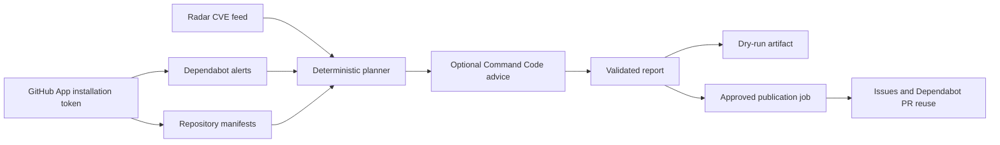

# Radar Security Auditor

Evidence-first dependency security auditing for repositories accessible to a GitHub App. Cloudflare Radar discovers newly published CVEs. GitHub Dependabot alerts and repository lockfiles establish whether a particular repository has a matching installed package. Command Code may explain the remediation, but it never decides exposure, writes to GitHub, or executes repository code.

This is a public GitHub template. It performs read-only auditing by default and does not require a Cloudflare Worker. Create a private repository from the template for your organization and add your own GitHub App configuration there.

## What this version does

- Reads Radar's documented [CVE feed](https://radar.cloudflare.com/zero-wire/cves/feed), including its JSON-feed representation.
- Lists repositories through a GitHub App installation instead of a personal classic token.
- Reads all open Dependabot alerts on each run, so feed truncation and late advisory mappings do not erase an existing alert.
- Limits issue publication plans to high and critical **Dependabot-confirmed** findings.
- Correlates a CVE with GHSA aliases and provides a potential-exposure input for repository lockfiles when Dependabot is unavailable.
- Reads pinned Python dependencies from `requirements*.txt`, `poetry.lock`, `uv.lock`, and `Pipfile.lock`, and applies PEP 440 version ranges and PEP 503 distribution-name normalization.
- Produces a stable finding identity from repository, advisory aliases, package, and manifest.
- Plans one issue per finding, checks existing marker-matched issues, and reuses matching Dependabot PRs.
- Refuses to reopen a previously closed issue.
- Provides reusable, credential-separated campaign publication code for teams that opt in.
- Provides deterministic issue templates when the model provider is disabled or fails.

It does not create replacement PRs yet, merge PRs, or infer exposure from CVE prose alone. `allowDependencyChanges` and `openDraftPrs` are explicit future opt-ins and currently still produce an issue plan.

## Why GitHub Actions

Detection is polling and reconciliation. Package-manager commands and target-repository tests need full source checkouts and GitHub-hosted runners. Actions already provides scheduling, concurrency, job isolation, and environment approvals without introducing a Worker, Queue, D1, or another credential store.

A Worker becomes reasonable when the project needs webhook ingestion or queueing across many installations. It would still enqueue validation and publication into Actions rather than running target-repository code at the edge.

## Architecture



## Local verification

Requires Node.js 22 or newer.

```bash
npm ci
npm run check
node dist/cli.js scan-fixture \
  --config tests/fixtures/basic/config.json \
  --fixtures tests/fixtures/basic \
  --dry-run true \
  --output artifacts/report.json
```

The fixture contains a malicious sentence inside an advisory description. The model boundary treats it as data, and deterministic policy never turns it into workflow changes.

## Configure

1. Create a private repository from this template for your audit hub.
2. Create a read-only GitHub App with metadata, contents, issues, pull requests, and Dependabot alert access. Install it on each owner whose repositories you want to audit.
3. Copy `config/repos.example.json` to `config/repos.json`, replace `your-github-owner` with an App-installed owner, and commit the personalized config to your private copy. With `inventory: "app-installations"`, every active repository visible to that installation is audited automatically. Newly discovered repositories are report-only until `publishIssues` is enabled for them. Add repository entries only to exclude repositories or override their policy.
4. Put the GitHub App ID and private key in repository Actions secrets `RADAR_GITHUB_APP_ID` and `RADAR_GITHUB_PRIVATE_KEY`.
5. Create the `radar-audit` environment. The checked-in schedule is read-only. Use a separate protected write environment only after you configure the campaign publisher.
6. For issue creation, create a separate Issues-write App and keep its credentials in a protected write environment. The campaign publisher validates an immutable preview, refreshes live alert state, and mints an Issues-only token scoped to the one approved repository.
7. Wire the campaign publisher into a local or fork-specific workflow that previews with `DO_NOT_WRITE`, then publishes only that exact preview by supplying its run ID, artifact ID, campaign key, and digests to a second run.
8. Optional: set `RADAR_COMMANDCODE_API_KEY` and `RADAR_COMMANDCODE_ENABLED=true`. Advice runs only for dry manual scans in a credential-isolated job that has no GitHub App secrets. Enabling requires confirming Provider API entitlement and zero-data-retention support for the selected model.
9. The campaign publisher derives and verifies the trusted issue author from the authenticated Writer App before each approved write. Legacy per-alert publication is not part of this template.

The scheduled scan never writes. The checked-in workflow omits legacy per-alert publication. Use the campaign publisher only after configuring its preview, approval, and write environment.

Verify the write environment's protection before adding write credentials. GitHub does not offer required reviewers for private-repo environments on every plan.

Never pass a personal `GITHUB_TOKEN` with cross-repository access. The hub's own workflow token is restricted to `contents: read`.

### Repository discovery and publication

The installed GitHub App is the discovery authority. The `installations` list selects installation owners, and the repository list is a set of optional overrides rather than the audit allowlist.

- An unlisted, active App-visible repository is audited automatically.
- An unlisted repository is report-only because `repositoryDefaults.publishIssues` defaults to `false`.
- Set `publishIssues: true` in `repositoryDefaults` to permit issues for all discovered repositories, or on an individual repository entry to opt that repository in.
- Set `enabled: false` on an individual entry to exclude it from an App-wide audit.
- Archived and disabled GitHub repositories are skipped.
- `inventory: "configured"` remains available as a locked-down mode that audits only explicitly enabled repositories.

## Model routing

| Tier    | Command Code model             | Use                                                    |
| ------- | ------------------------------ | ------------------------------------------------------ |
| Fast    | `deepseek/deepseek-v4.1-flash` | Summarize findings with complete upgrade evidence      |
| Complex | `z-ai/glm-5.3-flash`           | Explain findings with ambiguous or incomplete evidence |

The model receives sanitized advisory metadata and the exact installed versions that match the affected manifest and range. It does not receive repository source, issue bodies, workspace paths, or credentials. When the patched version, vulnerable range, installed version, or range validation is missing, advice is forced to `insufficient` and provides evidence-gathering steps without calling the provider. A provider response that reports insufficient evidence is replaced with the deterministic abstention. Provider calls use HTTPS, reject redirects, have bounded timeouts and response sizes, and request `x-cmd-zdr: 1` when ZDR is enabled. Fallback templates remain available if entitlement, ZDR, or the API is unavailable. No model-quality benchmark has established that a larger model produces better advice.

## Model and publication policy

- The feed's prose is untrusted discovery data.
- Dependabot is confirmation. A CVE record by itself is never a repository finding.
- A manifest match is labeled potential exposure until Dependabot confirms it. The scan reports it separately and never publishes it as a confirmed finding.
- A model may add an escaped advisory note but cannot alter package, version, issue action, repository list, or workflow.
- The write token is absent from plan, test, and model jobs.
- Publication is serialized and can require a protected environment.
- PRs, once implemented, must be Draft PRs with exact-path, base-SHA, and credential-free test-result checks.
- Human merge remains required.

## Repositories Dependabot may miss

The scan can miss a real issue even when the Radar CVE is present. It reports coverage gaps rather than treating absence of alerts as proof of safety. Cases include disabled Dependabot or dependency graph, unsupported package systems, Docker and OS packages, vendored code, and a new advisory that GitHub has not yet mapped. See [operations.md](docs/operations.md) for the response.

## Python support

Python campaigns currently use deterministic inventory and dependency-range evidence, then require manual review before remediation. The scanner records only packages with an exact installed version. It does not treat ranges, VCS URLs, editable installs, `requirements.in`, or unbuilt `pyproject.toml` declarations as installed evidence.

Supported lock and requirements formats:

| Manifest            | Evidence read                                              |
| ------------------- | ---------------------------------------------------------- |
| `requirements*.txt` | Direct `==` pins, including extras and environment markers |
| `poetry.lock`       | Each locked package name and version                       |
| `uv.lock`           | Each locked package name and version                       |
| `Pipfile.lock`      | Default and development locked versions                    |

PEP 440 handles epochs, prereleases, post releases, local versions, and Python constraint syntax. Python package names are normalized according to PEP 503 so `Zope.Interface`, `zope_interface`, and `zope-interface` identify the same dependency.

Python campaigns remain review-only. They do not run a package manager, rewrite a lockfile, create a PR, or claim that a version bump is compatible. An agent can use the issue evidence to make and test a repository-specific fix.

## Roadmap

1. npm remediation: identify the exact direct dependency or lockfile entry, run the real package manager, verify tarball integrity and the dependency graph, create a Draft PR, and run the target repository's required tests in a credential-free job.
2. GHSA/OSV range matching for repository-wide manifest inventory when Dependabot is disabled.
3. Python remediation: add a tested, repository-specific `pip`, Poetry, uv, or Pipfile updater and a credential-free validation path before enabling Python PR creation.
4. A Worker/Queue coordinator only after Actions polling is insufficient for events or installation scale.

## Source grounding

- [Cloudflare Radar CVE feed](https://radar.cloudflare.com/zero-wire/cves/feed)
- [GitHub Dependabot alerts API](https://docs.github.com/en/rest/dependabot/alerts)
- [GitHub Global Advisories API](https://docs.github.com/en/rest/security-advisories/global-advisories)
- [GitHub App installation authentication](https://docs.github.com/en/apps/creating-github-apps/authenticating-with-a-github-app/authenticating-as-a-github-app-installation)
- [Command Code Provider API](https://commandcode.ai/docs/provider)
